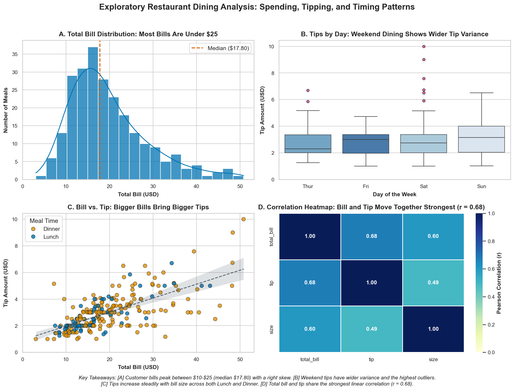
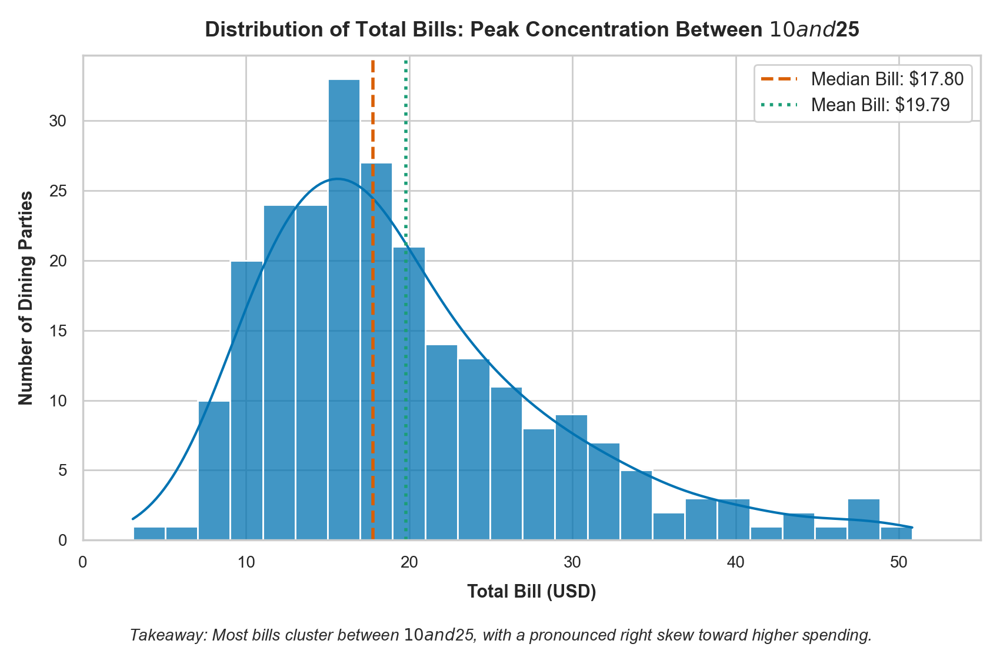
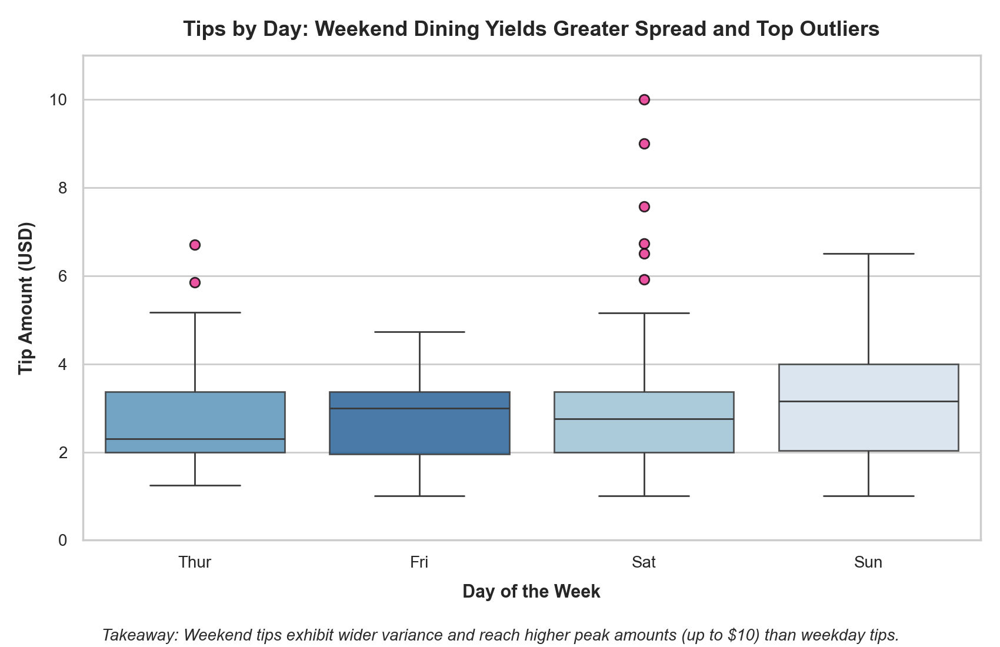
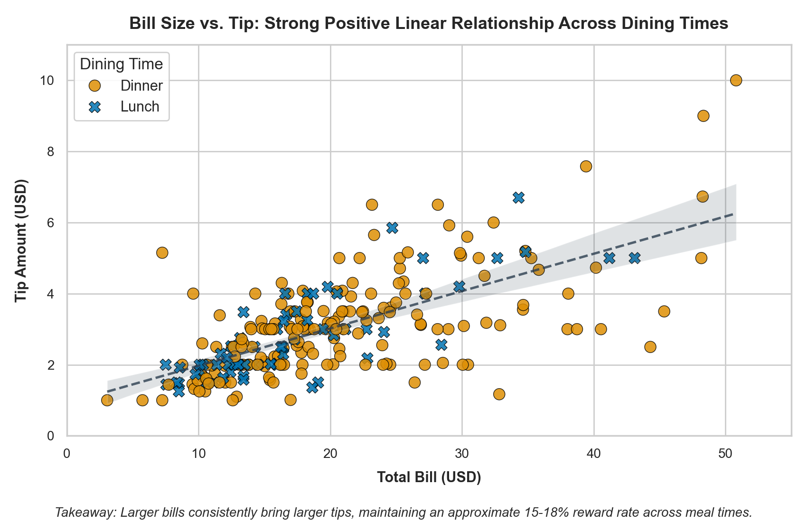
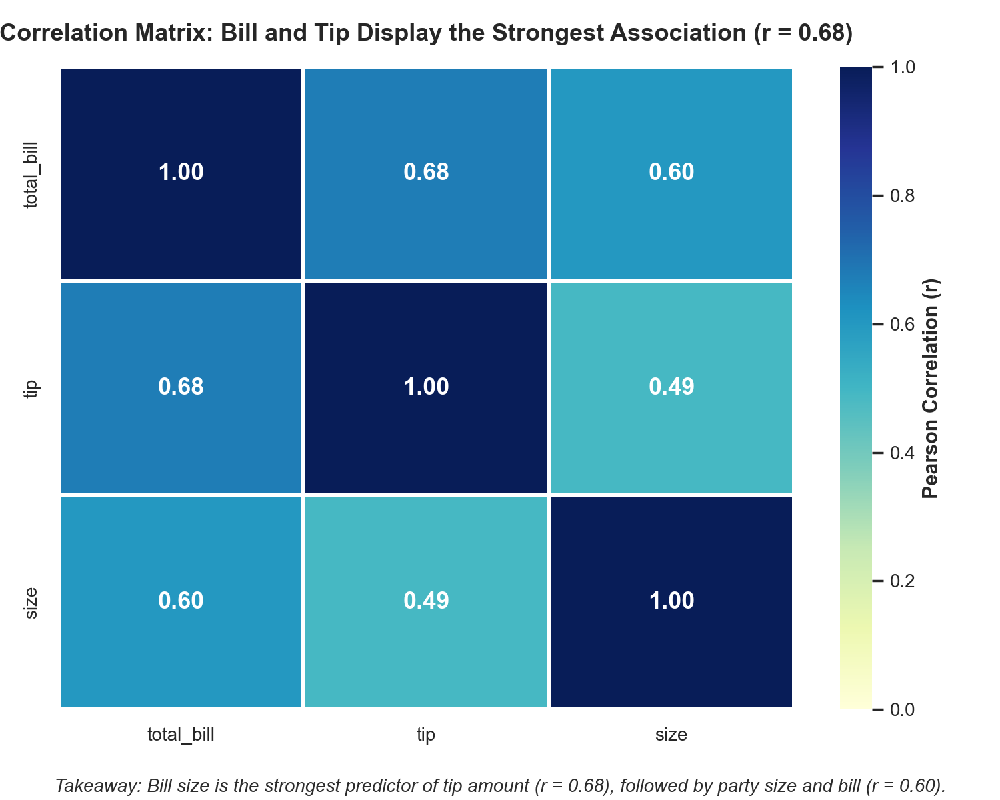
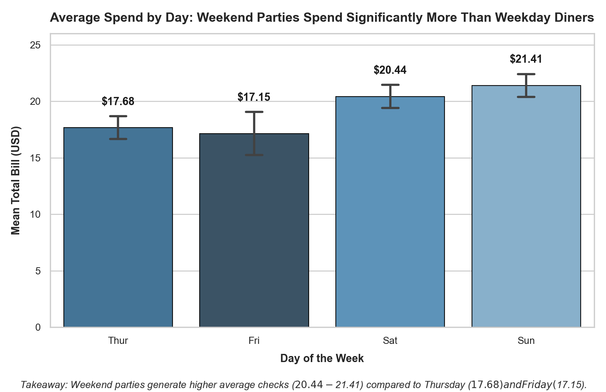
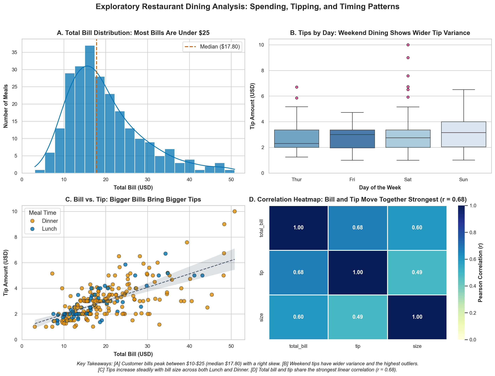

# Data Visualization with Matplotlib & Seaborn
**InternCircle Data Science & AI | Project 02**



---

## 📌 Project Overview
This project presents an end-to-end exploratory data visualization analysis using Python, Matplotlib, and Seaborn on the real-world **Restaurant Tips** dataset. 

The visualizations adhere strictly to modern data communication best practices:
- **Questions first**: Every visual graphic is designed to resolve a specific analytical question.
- **Honest representation**: Zero baselines are preserved on magnitude comparisons, axes are unclipped, and misleading 3D/pie charts are avoided.
- **Accessible aesthetics**: Uses Seaborn's accessible `colorblind` palette and intuitive sequential colormaps (`Blues`, `YlGnBu`), completely avoiding red-green clashes.
- **Informative titles**: Titles state the actual empirical finding rather than generic variable combinations.
- **Unambiguous takeaways**: Each figure is accompanied by an explicit one-line takeaway.

---

## 📂 Repository Structure

```text
01 DV and DM/
├── data_visualization.ipynb        # Complete interactive Jupyter Notebook with outputs
├── generate_visualizations.py      # Standalone Python script to regenerate all plots
├── generate_notebook.py            # Automated builder script for the notebook
├── tips.csv                        # Local copy of the 244-row Tips dataset
├── tips_overview.png               # Combined 2x2 dashboard (150 DPI - rubric requirement)
├── tips_dashboard.png              # Combined 2x2 dashboard (200 DPI publication quality)
├── project-2-guide.pdf             # InternCircle project guide & requirements
├── README.md                       # Complete documentation, takeaways & submission guide
└── figures/                        # Individual high-resolution figure exports
    ├── 01_bill_distribution_histogram.png
    ├── 02_tips_by_day_boxplot.png
    ├── 03_bill_vs_tip_scatterplot.png
    ├── 04_correlation_heatmap.png
    └── 05_average_bill_by_day_barchart.png
```

---

## ❓ Analytical Questions & Chart Mappings

| # | Question | Chart Type | Justification & Visual Encoding |
|---|----------|------------|---------------------------------|
| **1** | *How are total bills distributed across customer dining parties?* | **Histogram with KDE** | Visualizes continuous univariate distribution, skewness, and central clustering (median vs. mean). |
| **2** | *How do tipping amounts and variability differ across days of the week?* | **Box Plot** | Shows medians, interquartile ranges (IQR), and extreme outliers across categorical groups. |
| **3** | *Does a bigger meal bill yield a bigger tip, and does dining time alter this trend?* | **Scatter Plot** | Explores bivariate relationship between two continuous variables with `time` (Lunch vs. Dinner) as hue and an overlaid linear regression fit. |
| **4** | *Which numerical features (total bill, tip, and party size) correlate most strongly?* | **Correlation Heatmap** | Quantifies pairwise linear relationships using an annotated sequential colormap matrix. |
| **5** | *Which days of the week generate the highest average spend per party?* | **Bar Chart** | Directly compares categorical group means with error bars and an honest zero baseline ($y=0$). |

---

## 📊 Individual Charts & Written Takeaways

### 1. Total Bill Distribution


- **Question:** How are total bills distributed across dining parties?
- **Finding Title:** *Distribution of Total Bills: Peak Concentration Between $10 and $25*
- **Key Takeaway:**  
  > **Most dining checks cluster between $10 and $25 with a median of $17.80, displaying a pronounced right skew driven by infrequent large parties exceeding $40.**

---

### 2. Tips by Day of the Week


- **Question:** Do tipping amounts and variability differ across days of the week?
- **Finding Title:** *Tips by Day: Weekend Dining Features Greater Spread and Highest Outliers*
- **Key Takeaway:**  
  > **While median tips remain steady around $2.75–$3.00 across all days, Saturday and Sunday exhibit substantially wider interquartile ranges and peak outlier tips reaching up to $10.00.**

---

### 3. Total Bill vs. Tip Amount


- **Question:** Does a bigger meal bill yield a bigger tip, and does dining time alter this trend?
- **Finding Title:** *Bill Size vs. Tip: Strong Positive Linear Trend Across Dining Times*
- **Key Takeaway:**  
  > **Larger bills reliably yield higher tips with a consistent linear upward trajectory across both lunch and dinner sittings (averaging ~15%–18% gratuity).**

---

### 4. Correlation Heatmap


- **Question:** Which numerical metrics move together most strongly in the dataset?
- **Finding Title:** *Correlation Heatmap: Total Bill and Tip Share Strongest Link (r = 0.68)*
- **Key Takeaway:**  
  > **Total bill and tip amount share the strongest linear correlation ($r = 0.68$), followed by party size and bill ($r = 0.60$), while party size has a weaker direct link to tip ($r = 0.49$).**

---

### 5. Average Spend by Day (Honest Bar Chart)


- **Question:** Which days of the week generate the highest average total spend per party?
- **Finding Title:** *Average Spend by Day: Weekend Diners Spend Significantly More Than Weekday Diners*
- **Key Takeaway:**  
  > **Sunday ($21.41) and Saturday ($20.44) yield significantly higher average table spend than Thursday ($17.68) and Friday ($17.15), with zero baseline fully preserved.**

---

## 🎯 2x2 Combined Dashboard
The four core charts are integrated into a single 2x2 dashboard (`tips_overview.png` and `tips_dashboard.png`) saved at high resolution:



---

## ✅ Review for Honesty & Best Practices

| Standard Checklist Item | Implementation Details | Verdict |
|-------------------------|------------------------|:-------:|
| **Each chart fits its question** | Histogram for continuous distribution, boxplot for group spread, scatterplot for correlation, heatmap for pairwise matrix, bar chart for discrete means. | **Pass** |
| **Title states the finding** | Every title conveys actionable insight (e.g., *"Bigger Bills Bring Bigger Tips"* rather than *"Bill vs Tip"*). | **Pass** |
| **Honest axes and zero baselines** | Bar chart y-axis strictly originates at $0$; scatter and histogram x/y axes have sensible non-truncated limits. | **Pass** |
| **No 3D or pie charts** | All visual representations are planar 2D Cartesian or matrix heatmaps. | **Pass** |
| **Colorblind-safe design** | Styled with Seaborn `colorblind` palette, `Blues`, and `YlGnBu`. Avoids red-green combinations. | **Pass** |
| **No cut-off labels** | Figures sized generously (8.5x5.5 individual, 14x10.5 dashboard) and processed with `plt.tight_layout()`. | **Pass** |
| **One-line takeaway under each chart** | Every chart is paired with a clear, concise takeaway sentence. | **Pass** |

---

## 🚀 How to Run the Code Locally

### 1. Prerequisites
Ensure Python 3.10+ is installed:
```bash
pip install pandas seaborn matplotlib numpy
```

### 2. Generate All Figures and Dashboard
```bash
python generate_visualizations.py
```
This produces all image files in `figures/` and regenerates `tips_overview.png` and `tips_dashboard.png`.

### 3. Open the Jupyter Notebook
```bash
jupyter notebook data_visualization.ipynb
# or open directly in VS Code / Cursor / PyCharm
```

---

## 📤 Submission Instructions (InternCircle)

To submit your project on the InternCircle portal:
1. **GitHub Option (Recommended):**
   - Push this directory to your GitHub account (e.g. `github.com/<your-username>/interncircle-data-visualization`).
   - Ensure the repository visibility is set to **Public**.
   - Copy the repository URL.
2. **Google Drive Option:**
   - Compress or upload the project folder (including `data_visualization.ipynb`, `tips_overview.png`, and `README.md`) to Google Drive.
   - Set the sharing permission to **"Anyone with the link can view"**.
   - Copy the shareable link.
3. **Submit:**
   - Go to your InternCircle dashboard under **My Tasks** -> **Project 02: Data Visualization with Matplotlib & Seaborn**.
   - Paste the link and submit your written takeaways.
